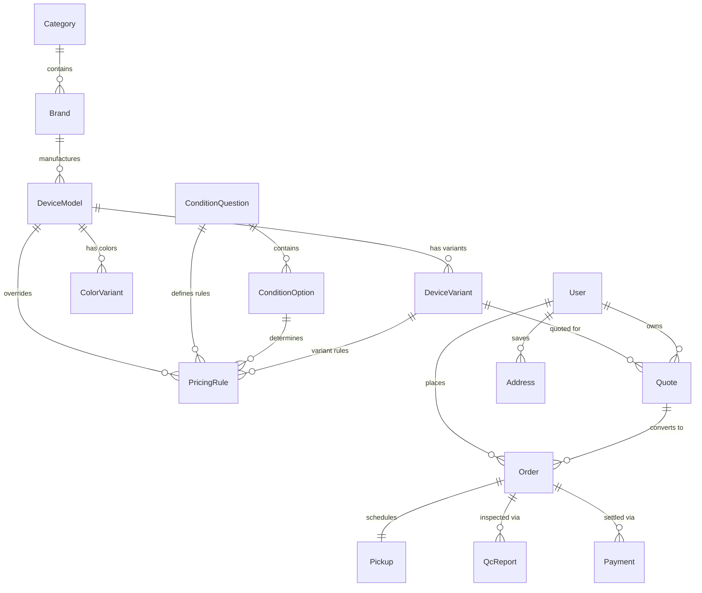

# CashALL — Complete Database Architecture & Pricing Engine Specification

> **Target Audience:** Mobile Application & Backend Engineering Team  
> **System Architecture:** PostgreSQL (Supabase), Prisma ORM, Next.js 14 Serverless Engine  
> **Generated Date:** September 2026  
> **Offline Package Files:**
> 1. `database_backups/cashall_catalog_and_pricing_export.json` (10.68 MB — Complete Offline Catalog & Pricing Seed)
> 2. `database_backups/cashall_schema_ddl.sql` (Complete PostgreSQL Table DDL with all Enums, Constraints & Indexes)
> 3. `prisma/schema.prisma` (Official Prisma Data Model)

---

## 1. Executive Summary & Zero-Impact Delivery

To prevent exhausting live production quotas on Supabase and Vercel, the complete database structure and catalog dataset have been extracted **entirely from local verified backups**. 

You do **not** need to connect directly to the production database to obtain the exact structure or data. All 2,441 device models, 27,267 device variants, condition questions, and valuation algorithms are packaged and documented below.

---

## 2. High-Level Entity Relationship Diagram (ERD)



---

## 3. Complete Table & Entity Dictionary

### A. Catalog & Device Hierarchy

#### 1. `Category`
Defines top-level hardware categories.
- `id` (UUID, Primary Key)
- `name` (TEXT) — e.g. "Mobiles", "Laptops", "Tablets"
- `slug` (TEXT, Unique) — `mobile`, `laptop`, `tablet`
- `active` (BOOLEAN, Default: `true`)
- `sortOrder` (INTEGER, Default: `0`)
- `createdAt`, `updatedAt`, `deletedAt` (TIMESTAMP)

#### 2. `Brand`
Hardware manufacturers.
- `id` (UUID, Primary Key)
- `name` (TEXT) — e.g. "Apple", "Samsung", "Xiaomi", "Vivo", "Realme", "OnePlus", "HP", "Dell"
- `slug` (TEXT, Unique) — e.g. `apple`, `samsung`
- `logoUrl` (TEXT, Nullable) — Hosted brand logo
- `category` (TEXT, Default: `'MOBILE'`)
- `active` (BOOLEAN, Default: `true`)
- `sortOrder` (INTEGER, Default: `0`)

#### 3. `DeviceModel`
Specific phone or laptop model.
- `id` (UUID, Primary Key)
- `brandId` (UUID, Foreign Key -> `Brand.id`)
- `questionSetId` (UUID, Foreign Key -> `QuestionSet.id`, Nullable)
- `name` (TEXT) — e.g. "iPhone 15 Pro Max", "Galaxy S24 Ultra", "MacBook Pro M3 14"
- `slug` (TEXT, Unique) — e.g. `apple-iphone-15-pro-max`
- `category` (TEXT, Default: `'MOBILE'`)
- `imageUrl` (TEXT, Nullable) — High-res device render
- `releaseYear` (INTEGER, Nullable) — e.g. `2024`
- `basePrice` (FLOAT, Nullable) — High-level reference price
- `popular` (BOOLEAN, Default: `false`) — Pinned to top search & home page
- `active` (BOOLEAN, Default: `true`)

#### 4. `DeviceVariant`
Individual hardware configuration (storage, RAM, base procurement price).
- `id` (UUID, Primary Key)
- `modelId` (UUID, Foreign Key -> `DeviceModel.id`)
- `ram` (TEXT, Nullable) — e.g. `"8 GB"`, `"16 GB"`
- `storage` (TEXT) — e.g. `"128 GB"`, `"256 GB"`, `"512 GB"`, `"1 TB"`
- `basePrice` (FLOAT) — **The initial maximum valuation price for a flawless device**
- `active` (BOOLEAN, Default: `true`)
- `sortOrder` (INTEGER, Default: `0`)

#### 5. `ColorVariant`
- `id` (UUID, Primary Key)
- `modelId` (UUID, Foreign Key -> `DeviceModel.id`, Nullable)
- `variantId` (UUID, Foreign Key -> `DeviceVariant.id`, Nullable)
- `colorName` (TEXT) — e.g. "Natural Titanium", "Midnight Black"
- `hexCode` (TEXT, Nullable) — e.g. `"#8A8680"`
- `imageUrl` (TEXT, Nullable)

---

### B. Dynamic Inspection Questionnaire & Pricing Engine

#### 6. `ConditionQuestion`
Assessment questions presented during the sell evaluation wizard.
- `id` (UUID, Primary Key)
- `questionSetId` (UUID, Nullable)
- `title` (TEXT) — e.g. "Does the touchscreen work properly?", "Are there scratches on the screen?"
- `subtitle` (TEXT, Nullable)
- `group` (TEXT) — Enum group:
  - `BASIC` (Powers on, calls work)
  - `SCREEN` (Touch, cracks, dead pixels, lines, discoloration)
  - `BODY` (Scratches, dents, bent frame, broken back glass)
  - `FUNCTIONAL` (Camera, speaker, mic, FaceID/Fingerprint, Wi-Fi, battery health)
  - `ACCESSORIES` (Original charger, box, valid bill)
  - `REPAIR` (Screen replaced, motherboard repaired)
- `type` (TEXT, Default: `'SINGLE'`) — `'SINGLE'` or `'MULTIPLE'`
- `sortOrder` (INTEGER, Default: `0`)
- `isRequired` (BOOLEAN, Default: `true`)
- `active` (BOOLEAN, Default: `true`)

#### 7. `ConditionOption`
Selectable options for each question.
- `id` (UUID, Primary Key)
- `questionId` (UUID, Foreign Key -> `ConditionQuestion.id`)
- `label` (TEXT) — e.g. "Flawless", "Minor Scratches", "Cracked Screen", "No Issues"
- `description` (TEXT, Nullable)
- `iconName` (TEXT, Nullable)
- `sortOrder` (INTEGER, Default: `0`)
- `active` (BOOLEAN, Default: `true`)

#### 8. `PricingRule`
Rules connecting condition options to price deductions or bonuses.
- `id` (UUID, Primary Key)
- `modelId` (UUID, Nullable -> applies to all models if NULL)
- `variantId` (UUID, Nullable -> applies to all variants if NULL)
- `questionId` (UUID, Foreign Key -> `ConditionQuestion.id`)
- `optionId` (UUID, Foreign Key -> `ConditionOption.id`)
- `ruleType` (TEXT) — `'PERCENTAGE_DECREASE'`, `'FIXED_DECREASE'`, `'BONUS'`, `'NO_CHANGE'`
- `adjustmentType` (TEXT, Default: `'PERCENTAGE_DEDUCTION'`)
- `adjustmentValue` (FLOAT) — Percentage (e.g. `15.0` for 15%) or Fixed Rupee amount (e.g. `1200`)
- `minValue` (FLOAT, Nullable)
- `maxValue` (FLOAT, Nullable)
- `priority` (INTEGER, Default: `0`)
- `active` (BOOLEAN, Default: `true`)

---

## 4. Valuation & Pricing Calculation Algorithm

CashALL uses a deterministic valuation engine implemented in `PricingService.calculateQuote`:

```typescript
// 1. Fetch Base Price
const basePrice = variant.basePrice;

// 2. Iterate Selected Questionnaire Answers
let totalDeductions = 0;
let totalBonuses = 0;

for (const answer of answers) {
  const rule = findMatchingRule(answer.questionId, answer.optionId, variant.id);
  if (!rule) continue;

  if (rule.adjustmentType === "PERCENTAGE_DEDUCTION") {
    const pct = rule.adjustmentValue; // e.g. 15%
    const deduction = Math.round((basePrice * pct) / 100);
    totalDeductions += deduction;
  } else if (rule.adjustmentType === "FIXED_DEDUCTION") {
    totalDeductions += Math.abs(rule.adjustmentValue);
  } else if (rule.adjustmentType === "FIXED_BONUS") {
    totalBonuses += Math.abs(rule.adjustmentValue);
  }
}

// 3. Raw Valuation
const rawEstimated = basePrice - totalDeductions + totalBonuses;

// 4. Floor Price Guarantee (Protects payout from dropping to zero)
// Payout cannot fall below 15% of base price or ₹500
const floorPrice = Math.max(500, Math.round(basePrice * 0.15));
const finalEstimatedPrice = Math.max(floorPrice, Math.round(rawEstimated));
```

---

### C. Order Lifecycle & Fulfillment

#### 9. `Quote`
- `id` (UUID, Primary Key)
- `quoteNumber` (TEXT, Unique) — e.g. `CAQ58570`
- `variantId` (UUID, Foreign Key -> `DeviceVariant.id`)
- `customerPhone` (TEXT, Nullable) — Customer phone for lookup & SMS
- `customerName` (TEXT, Nullable)
- `userId` (UUID, Foreign Key -> `User.id`, Nullable)
- `basePrice` (FLOAT)
- `totalDeductions` (FLOAT)
- `estimatedPrice` (FLOAT)
- `selectedAnswersJson` (TEXT / JSON) — Complete question & answer array
- `breakdownJson` (TEXT / JSON) — Itemized deduction breakdown
- `status` (TEXT, Default: `'ACTIVE'`)
- `expiresAt` (TIMESTAMP) — Valid for 48 hours

#### 10. `Order`
- `id` (UUID, Primary Key)
- `orderNumber` (TEXT, Unique) — e.g. `CA70678`
- `quoteId` (UUID, Foreign Key -> `Quote.id`)
- `userId` (UUID, Foreign Key -> `User.id`)
- `addressId` (UUID, Foreign Key -> `Address.id`)
- `assignedAgentId` (UUID, Foreign Key -> `User.id`, Nullable)
- `status` (ENUM `OrderStatus`):
  - `QUOTE_CREATED`
  - `PICKUP_SCHEDULED`
  - `PARTNER_ASSIGNED`
  - `PARTNER_ON_THE_WAY`
  - `INSPECTION_STARTED`
  - `FINAL_OFFER_PENDING`
  - `ACCEPTED`
  - `DECLINED`
  - `PAYMENT_PROCESSING`
  - `PAID`
  - `COMPLETED`
  - `CANCELLED`
- `finalPrice` (FLOAT, Nullable) — Final agreed amount after physical inspection
- `preferredDate` (TEXT / TIMESTAMP)
- `preferredTimeSlot` (TEXT) — e.g. `"10:00 AM - 01:00 PM"`
- `cancellationReason` (TEXT, Nullable)

#### 11. `Pickup`
- `id` (UUID, Primary Key)
- `orderId` (UUID, Foreign Key -> `Order.id`)
- `scheduledDate` (TIMESTAMP)
- `timeSlot` (TEXT)
- `status` (TEXT)
- `agentNotes` (TEXT, Nullable)

#### 12. `QcReport`
Physical inspection checklist filled by the field agent.
- `id` (UUID, Primary Key)
- `orderId` (UUID, Foreign Key -> `Order.id`)
- `physicalCondition` (TEXT)
- `functionalIssues` (TEXT)
- `deviceImages` (TEXT[] / JSON) — Photos taken by agent
- `finalOfferPrice` (FLOAT)
- `customerAgreed` (BOOLEAN)

#### 13. `Payment`
- `id` (UUID, Primary Key)
- `orderId` (UUID, Foreign Key -> `Order.id`)
- `amount` (FLOAT)
- `method` (ENUM: `'UPI'`, `'BANK_TRANSFER'`, `'CASH'`)
- `status` (ENUM: `'PENDING'`, `'PROCESSING'`, `'PAID'`, `'FAILED'`)
- `transactionRef` (TEXT, Nullable) — UTR number or UPI transaction ID
- `proofUrl` (TEXT, Nullable) — Screenshot proof

---

### D. User Management & Audit

#### 14. `User`
- `id` (UUID, Primary Key)
- `phone` (TEXT, Unique)
- `name` (TEXT, Nullable)
- `email` (TEXT, Unique, Nullable)
- `role` (ENUM: `'CUSTOMER'`, `'ADMIN'`, `'SUPER_ADMIN'`, `'EMPLOYEE'`, `'AGENT'`)
- `status` (TEXT, Default: `'ACTIVE'`)
- `firebaseUid` (TEXT, Unique)

#### 15. `Address`
- `id` (UUID, Primary Key)
- `userId` (UUID, Foreign Key -> `User.id`)
- `fullName`, `phone`, `house`, `street`, `area`, `landmark`, `city`, `state`, `pincode`
- `latitude`, `longitude` (FLOAT, Nullable)

#### 16. `AuditLog`
Audit trails for order reassignments, status changes, and operator logins.
- `id` (UUID, Primary Key)
- `actorId` (UUID)
- `actorRole` (TEXT)
- `action` (TEXT) — e.g. `ORDER_UPDATED`, `AGENT_LOGIN`, `STATUS_CHANGED`
- `tableName` (TEXT)
- `recordId` (UUID)
- `oldValuesJson` (TEXT, Nullable)
- `newValuesJson` (TEXT, Nullable)
- `createdAt` (TIMESTAMP)

---

## 5. Offline Seed Files Ready for Import

The complete dataset is exported locally and ready for import into any local or staging database:

| File Path | Format | Size | Description |
|---|---|---|---|
| `database_backups/cashall_catalog_and_pricing_export.json` | JSON | 10.68 MB | Full dataset with 3 categories, 28 brands, 2,441 models, 27,267 variants, questions, and pricing rules |
| `database_backups/cashall_schema_ddl.sql` | SQL | ~35 KB | Ready-to-run PostgreSQL DDL (Enums, Tables, Foreign Keys, Indexes) |
| `prisma/schema.prisma` | Prisma | ~24 KB | Standard Prisma ORM schema |

### Quick Import Command (PostgreSQL):
```bash
# 1. Create schema
psql -U your_user -d your_db -f database_backups/cashall_schema_ddl.sql

# 2. Or if using Prisma in your app:
npx prisma db push
```

---

## 6. Cached Edge API Alternative (Recommended for Mobile App)

If you are building an Android/iOS app, you do **not** need direct database credentials. You can fetch and synchronize catalog data directly via our cached edge APIs with zero egress risk:

1. **Fetch All Brands & Popular Devices:**
   - `GET https://www.cashall.in/api/v1/catalog`
   - Cache-Control: `public, s-maxage=300, stale-while-revalidate=600`
2. **Fetch Models for a Specific Brand:**
   - `GET https://www.cashall.in/api/v1/catalog?brand=apple`
   - Returns all Apple models and their variants (RAM, storage, base prices).
3. **Calculate Valuation Quote:**
   - `POST https://www.cashall.in/api/v1/quotes/calculate`
   - Body: `{ "variantId": "<UUID>", "answers": [...] }`
4. **Serviceability Pincode Check:**
   - `GET https://www.cashall.in/api/v1/serviceability?pincode=700001`
